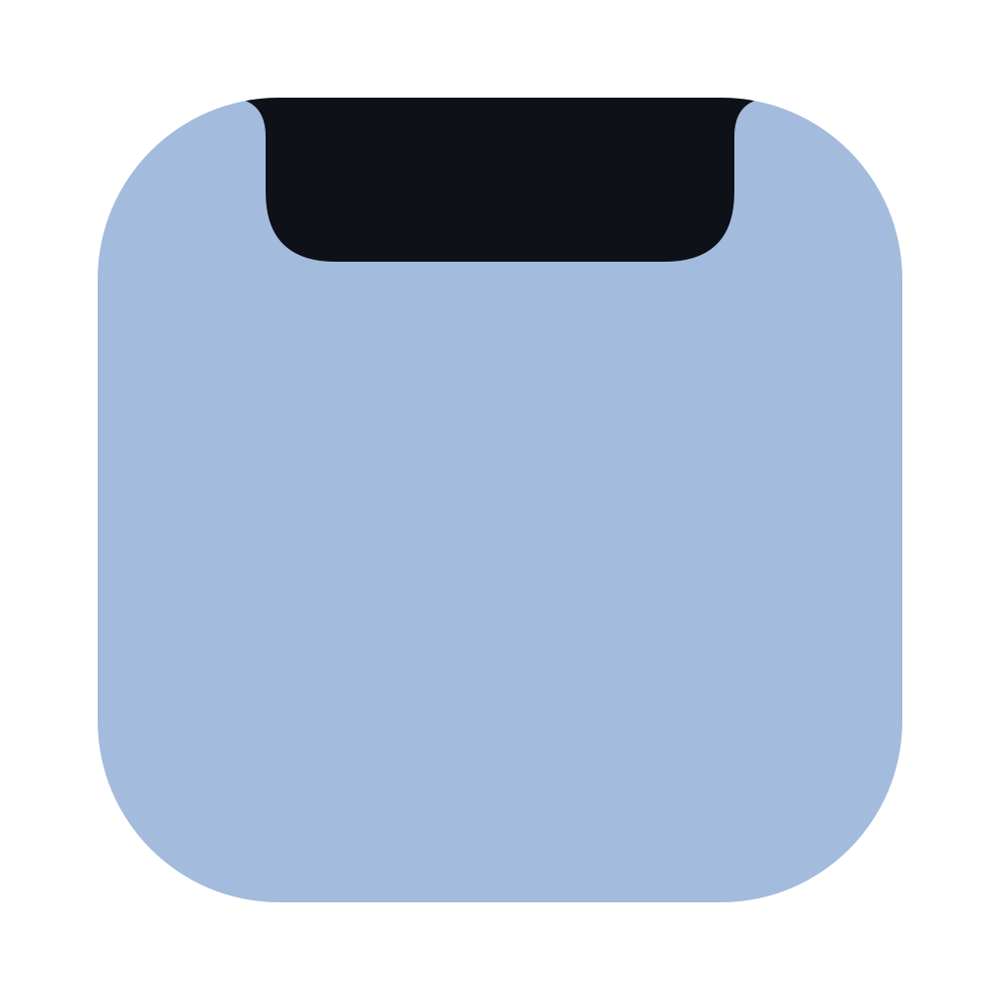
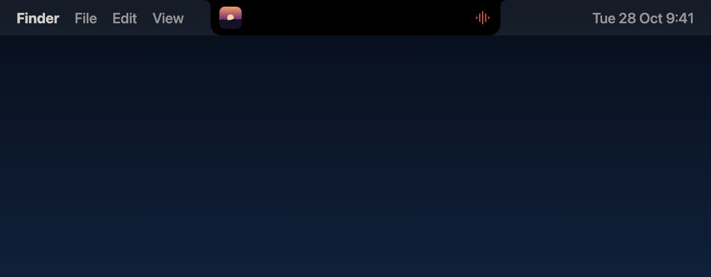
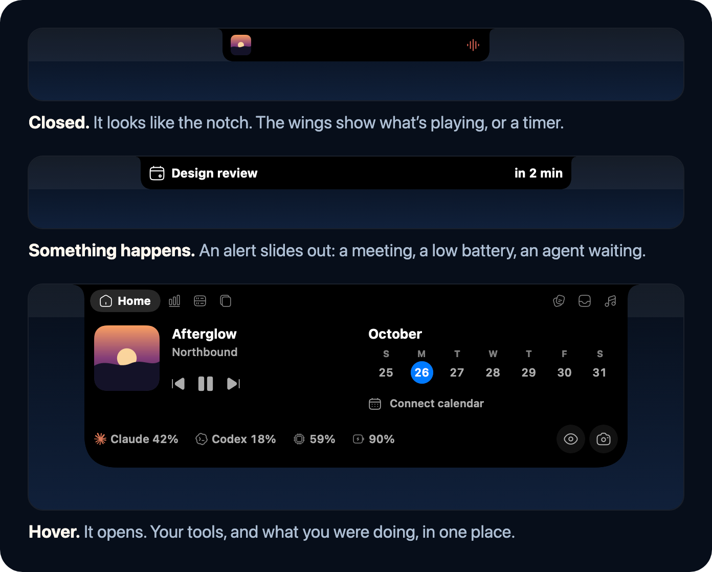
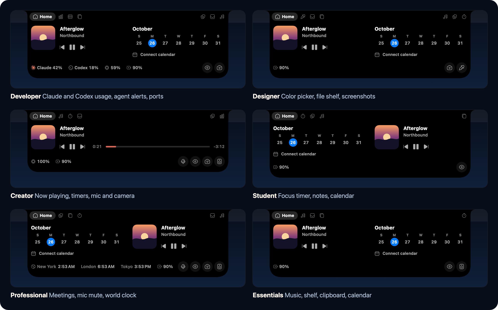
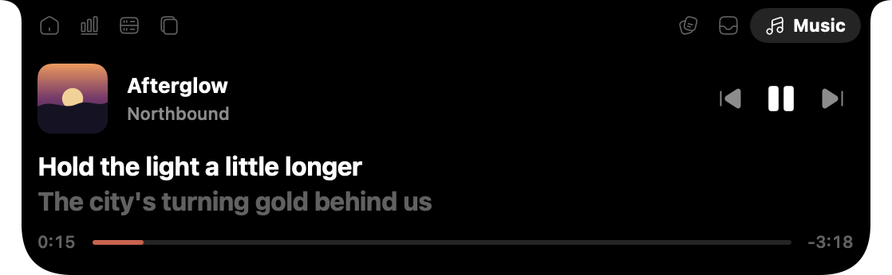
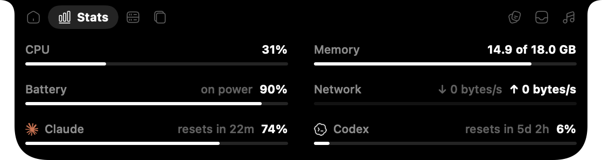
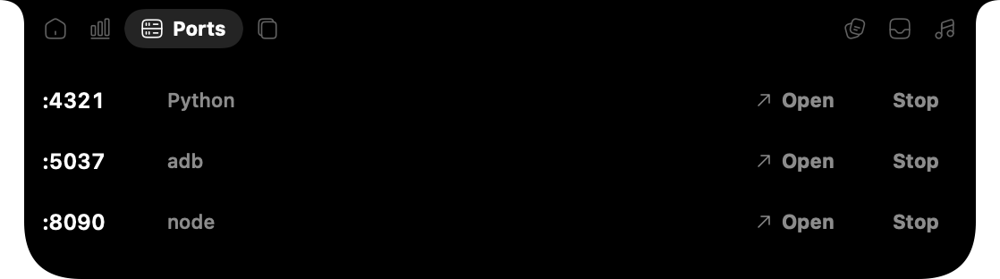
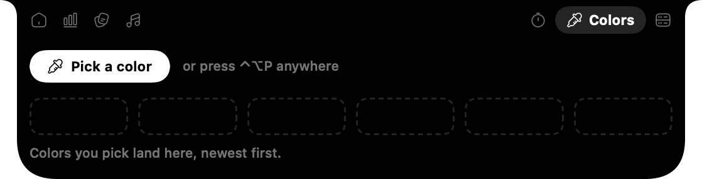

<p align="center">
  
</p>

<h1 align="center">Ledge</h1>

<p align="center">
  The MacBook notch, put to work. Free and open source.
</p>

<p align="center">
  <a href="https://github.com/notsocj/ledge/releases/latest"></a>
  <a href="https://github.com/notsocj/ledge/releases"></a>
  
  <a href="LICENSE"></a>
</p>

<p align="center">
  <a href="https://github.com/notsocj/ledge/releases/latest/download/Ledge.dmg"><b>Download for Mac</b></a>
  &nbsp;·&nbsp;
  <a href="#install">Homebrew</a>
  &nbsp;·&nbsp;
  <a href="#build-it-yourself">Build it yourself</a>
</p>

<p align="center">
  
</p>

Ledge turns the MacBook notch into a small, quiet island of everyday tools. Hover the notch and it
opens: what's playing, your week, quick actions, and a single status row for everything else. Brief
alerts (volume, battery, a meeting starting, an AI agent waiting on you) slide out beside the notch
while it's closed. On Macs without a notch it sits at the top of the screen as a pill.

## Install

[Download Ledge.dmg](https://github.com/notsocj/ledge/releases/latest/download/Ledge.dmg), open it and
drag Ledge to Applications. Or with Homebrew:

```sh
brew tap notsocj/ledge && brew trust notsocj/ledge
brew install --cask notsocj/ledge/ledge
```

Ledge needs macOS 14 or later on Apple Silicon. Releases are signed and notarized by Apple.

## How it works



## What you do decides what you get

On first launch you tell Ledge what you do: Developer, Designer, Creator, Student, Professional or
Essentials. Each one ranks the tools, so Ledge switches on what fits, puts your most-used tabs nearest
the notch, and chooses what Home and the closed notch show.



Pick more than one and each tool takes its best rank; the first one you picked breaks ties and
decides Home. Change it any time in Settings, where every tool can also be switched on or off.

## Tools

<table>
  <tr>
    <td width="50%"><br><b>Now playing</b>, with synced lyrics</td>
    <td width="50%"><br><b>Stats</b>: CPU, memory, network, battery, Claude and Codex limits</td>
  </tr>
  <tr>
    <td><br><b>Ports</b>: what's running on localhost, and stop it</td>
    <td><br><b>Colors</b>: pick from anywhere on screen, keep a palette</td>
  </tr>
</table>

**In the island:** Home · Now playing with synced lyrics · File shelf · Color picker · Clipboard
history · Timer and focus sessions · Notes · System stats · Localhost ports · Calendar week on Home

**Everywhere:** Volume and brightness in the notch · Battery and AirPods alerts · Meeting countdown ·
Agent alerts for Claude Code and Codex · Mic mute · Mic and camera in use · Window snapping · Keep
awake · Screenshots · Audio output switching · World clock · Menu bar icon settings

| Shortcut | Does |
| --- | --- |
| ⌃⌥ ← → ↑ ↓ | Snap the front window to a half of the screen |
| ⌃⌥ ↩ | Fill the screen with the front window |
| ⌃⌥ S | Screenshot an area (saved, copied, and put on the shelf) |
| ⌃⌥ P | Pick a color anywhere on screen |
| ⌃⌥ M | Mute or unmute the microphone |

## Privacy

Everything stays on the Mac. Clipboard history is kept in memory only, and items password managers
mark as secret are skipped. Notes are a file in `~/Library/Application Support/Ledge`. Calendar
events are read through macOS's own calendar access and never leave the Mac.

Two things go over the network: synced lyrics are looked up on [LRCLIB](https://lrclib.net) by song
title and artist, and the Claude usage meter asks Anthropic's API using the login Claude Code already
saved in your Keychain (read only; Ledge never refreshes or changes it).

Agent alerts, when you connect them in Settings, add a small command to `~/.claude/settings.json`
and `~/.codex/config.toml`. Ledge asks first, saves a backup of each file next to it, and keeps an
existing Codex `notify` command working by running it afterwards. Disconnect removes it again.

## Build it yourself

Requires macOS 14 or later, Apple Silicon, Xcode (Swift 6) and CMake.

```bash
./build.sh && open build/Ledge.app
```

`build.sh` fetches and builds [mediaremote-adapter](https://github.com/ungive/mediaremote-adapter),
builds the app, and assembles `build/Ledge.app`. Tests: `swift test`.

Builds are signed ad hoc, for the Mac they're built on. macOS treats each build as a new app, so after
rebuilding, remove and re-add Ledge under System Settings › Privacy & Security › Accessibility.

To review the design without clicking through it, `open build/Ledge.app --args --snapshot <folder>`
renders every persona, tab, setup step and closed-notch banner to PNGs and quits. It previews layouts
without changing your settings.

## Layout

```
Sources/Ledge/
  LedgeApp.swift       app entry, menu bar item, Settings window
  NotchPanel.swift       the island window, hover, banners, tool wiring
  NotchView.swift        island shell: closed states, tab pills, open layout
  Design.swift           colours, type scale, motion, notch shape, icons, buttons
  Persona.swift          personas and how they merge into a layout
  Preferences.swift      tools, switches, Settings
  Onboarding.swift       setup inside the island
  MediaTab.swift, NowPlaying.swift, Lyrics.swift, Usage.swift
  Tools/                 one file per tool
Icons/                   Solar icons (SVG) and the Claude and Codex marks
Tests/LedgeTests/
```

## Credits

- Icons: [Solar](https://www.figma.com/community/file/1166831539721848736) by 480 Design, CC BY 4.0,
  via [Iconify](https://iconify.design). Credited in Settings as the license requires.
- Now playing: [mediaremote-adapter](https://github.com/ungive/mediaremote-adapter) by Jonas van den
  Berg, BSD 3-Clause; its license ships inside the app.
- Synced lyrics: [LRCLIB](https://lrclib.net).
- The Claude and Codex marks belong to Anthropic and OpenAI and identify whose usage is shown.

## Releasing

`./build.sh dmg` also packs `site/Ledge.dmg`. `./build.sh release` signs that DMG with your Developer
ID, sends it to Apple for notarization, staples the ticket, checks that Gatekeeper accepts it, and
publishes it as the GitHub Release for the version in `Info.plist` (bump `CFBundleShortVersionString`
first). The site's Download buttons and the [Homebrew cask](https://github.com/notsocj/homebrew-ledge)
both fetch `releases/latest/download/Ledge.dmg`, so nothing else needs updating. It needs, once:

1. A **Developer ID Application** certificate: Xcode › Settings › Accounts › Manage Certificates › + ›
   Developer ID Application.
2. Notarization credentials saved in your keychain: `xcrun notarytool store-credentials ledge`
   (it asks for your Apple ID, team ID and an app-specific password from account.apple.com).

Downloads per release: `gh api repos/notsocj/ledge/releases --jq '.[] | "\(.tag_name) \(.assets[0].download_count)"'`.

Builds are signed with the Developer ID whenever the certificate is present, with the hardened runtime
and the calendar entitlement in `Ledge.entitlements`.

## Showreel and README pictures

`video/` is a Remotion project (`cd video && npm i && npm run dev` to preview). It holds:

- `LedgeShowreel`, a 42-second motion showreel voiced and scored with ElevenLabs (voice: Justin Case).
- `LedgeOneTake`, a 29-second cut with one continuous camera that follows a cursor across a MacBook
  and dives into the notch. Its camera is simulated in `video/src/onetake/rig.ts`.
- `ReadmeLoop`, `ReadmeMoments` and `ReadmePersonas`, the pictures in this README (`video/src/readme`).

Render with `npx remotion render <id> out/<name>.mp4`; the README loop is
`npx remotion render ReadmeLoop ../docs/readme/ledge.gif --codec gif --every-nth-frame 2`, and the stills
`npx remotion still ReadmeMoments ../docs/readme/moments.png` (same for `ReadmePersonas`). The island
images in `video/public/img` are copies of `site/assets`, made with `--snapshot`.

## Contributing

Issues and pull requests are welcome. Run `swift test` before sending a change, and use
`--snapshot` (see Building) to check how it looks across personas.

## Known gaps

- No in-app updates yet (Sparkle is planned); download new releases from GitHub or use `brew upgrade --greedy`.
- Lyrics come from a crowd-sourced service without a lyrics license.
- The Claude usage endpoint is undocumented; check Anthropic's terms for this use of Claude Code's login.
- Now playing and brightness use private macOS APIs that can change in updates.
- Confirm the Ledge name with a trademark search.
